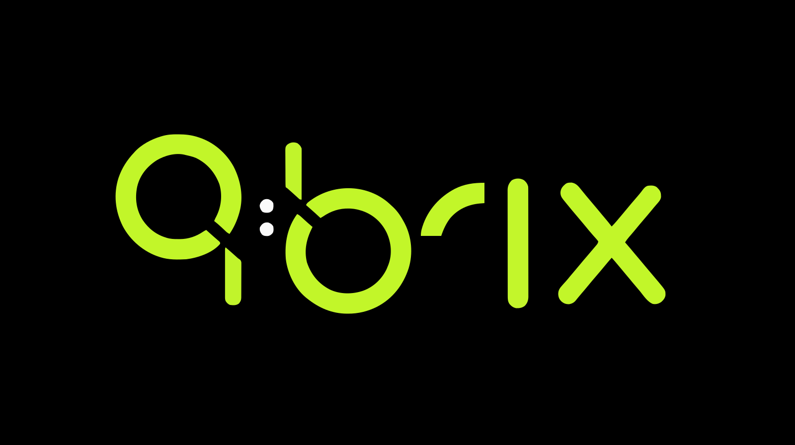

<p align="center">
  
</p>

<p align="center">
  <strong>Python SDK for qbrix, the open-source decision engine.</strong>
</p>

<p align="center">
  <a href="LICENSE"></a>
  
  
  
  
</p>


---

> [!WARNING]
> **This is a pre-release for qbrix next.** It speaks only to a qbrix server with next switched on (`PROXY_NEXT_ENABLED=true`), and it can break between phases. `pip install qbrix` keeps installing the stable 0.3.x.

<!-- next-target -->
Built against **qbrix next · phase 1 (Skeleton)**, server [`optiq-io/qbrix@372219e`](https://github.com/optiq-io/qbrix/commit/372219e).
<!-- /next-target -->

Typed sync and async clients for [qbrix](https://qbrix.io): ask a loop for a decision, and report what happened.

## Installation

```bash
pip install --pre "qbrix[http]"   # HTTP/JSON transport (httpx)
pip install --pre "qbrix[grpc]"   # gRPC transport (grpcio)
pip install --pre "qbrix[all]"    # both
```

## Quick Start

```python
from qbrix import Qbrix

client = Qbrix(api_key="optiq_…", base_url="https://qbrix.example.com")
decision = client.select(
    "checkout-headline",
    context={"unit": "user-1", "properties": {"device": "mobile"}},
    settings={"offline": {"key": "control", "config": {"headline": "Checkout"}}},
)
decision.option.config     # what to render
decision.reason            # "live", "draft", "paused" or "offline"
client.outcome(decision.request_id, 1)
```

- **`select(loop, context, settings=None)`** takes the loop's key or id. `context.unit` says who the decision is for and is required; the SDK checks it before any call. `properties` are what the app knows about the request: device, plan, country. It returns a `Decision(option, request_id, reason)`.
- **`request_id`** is there only when the decision can learn: a live loop. A draft or paused loop answers its fallback without one.
- **`outcome(request_id, value, *, id=None, at=None)`** reports what happened after one decision. The value must fit the loop's metric (a conversion is 0 or 1). A `None` request_id sends nothing, so call it unconditionally. Each call carries an event `id`, minted by the SDK when you don't pass one, so a retried call counts once. `at` is a `datetime` for when it happened; without one, qbrix uses the time it receives the outcome.

## When qbrix can't be reached

`select` never raises because qbrix is down. On a connection error, a timeout, a 429 or a 5xx (gRPC `UNAVAILABLE`, `DEADLINE_EXCEEDED`), it returns your `offline` option with reason `offline` and no `request_id`, or `option=None` when you gave none. Errors in the call itself still raise, because they are bugs to fix: a missing unit, a bad key (`AuthenticationError`) or an unknown loop (`NotFoundError`, with the server's message).

```python
decision = client.select(
    "checkout-headline",
    context={"unit": "user-1"},
    settings={
        "offline": {"key": "control", "config": {"headline": "Checkout"}},
        "timeout": 0.3,
        "max_retries": 0,
    },
)
```

`settings` keeps the select call on your request path within budget: `timeout` and `max_retries` override the client's for this call only. See [`examples/offline.py`](examples/offline.py).

## Async

```python
from qbrix import AsyncQbrix

async with AsyncQbrix(api_key="optiq_…") as client:
    decision = await client.select("checkout-headline", context={"unit": "user-1"})
    await client.outcome(decision.request_id, 1)
```

## Self-hosted qbrix

qbrix is [open source](https://github.com/optiq-io/qbrix). Run it with the
[self-hosting guide](https://qbrix.io/docs/self-hosting): `bin/selfhost-init` and
`docker compose up -d` from the repository, or the Helm chart. Then register in the
console and create an API key under **Settings → API keys**.

`QBRIX_BASE_URL` is the address of your install, not of the API path: the SDK adds
`/api/...` itself.

| Install | `QBRIX_BASE_URL` |
|---|---|
| Docker Compose quickstart | `http://localhost:8000` (or your `CONSOLE_URL` once it's on a real host) |
| Helm chart | your ingress origin, e.g. `https://qbrix.example.com` |
| Managed hosting | the URL you were given for your deployment |

The compose gateway and the chart's default ingress serve HTTP only, so use `qbrix[http]`.
gRPC needs a direct route to the proxy's gRPC port (`50050`), for example from a
service in the same cluster.

## Transports

The same `Qbrix` client, resources, and Pydantic models work over either wire format — only the transport differs:

```python
from qbrix import Qbrix

# HTTP — your install's gateway or ingress
client = Qbrix(transport="http", base_url="http://localhost:8000")

# gRPC — a directly-reachable proxy (local dev shown; or an in-cluster address)
client = Qbrix(transport="grpc", base_url="grpc://localhost:50050")
```

When `transport` is omitted it's resolved in this order: the `transport=` kwarg → the `QBRIX_TRANSPORT` env var → the `base_url` scheme (`grpc://` / `grpcs://` → gRPC) → HTTP.

gRPC needs a directly-reachable proxy gRPC endpoint. An install served over HTTPS behind a gateway or CDN usually does **not** expose gRPC — use `transport="http"` for it. Reach for gRPC against a local proxy (`grpc://localhost:50050`) or a service deployed alongside the proxy.

The gRPC transport covers `select`, `outcome`, and the pool, experiment, gate and policy operations. The `runtime` resource is HTTP-only (the proxy doesn't expose it over gRPC) — calling it on a gRPC client raises `NotImplementedError`. Install `qbrix[all]` and use `transport="http"` if you need it.

## Configuration

Constructor kwargs take priority over environment variables, which take priority over defaults.

```bash
export QBRIX_API_KEY="optiq_xxx"
export QBRIX_BASE_URL="http://localhost:8000"
```

```python
from qbrix import Qbrix

client = Qbrix()  # picks up env vars automatically
```

| Env Var | Default | Description |
|---------|---------|-------------|
| `QBRIX_API_KEY` | `None` | API key (`optiq_xxx`) |
| `QBRIX_BASE_URL` | `http://localhost:8000` | Your install's origin, without `/api` (the compose quickstart's gateway by default) |
| `QBRIX_TRANSPORT` | _(auto)_ | `http` or `grpc` — overrides URL-scheme detection |
| `QBRIX_TIMEOUT` | `5.0` | Request timeout / gRPC deadline (seconds) |
| `QBRIX_MAX_RETRIES` | `0` | Retry count on transient failures (429/5xx, gRPC `UNAVAILABLE`) |

gRPC-only knobs: `QBRIX_GRPC_KEEPALIVE_TIME_MS` (`30000`), `QBRIX_GRPC_KEEPALIVE_TIMEOUT_MS` (`10000`), `QBRIX_GRPC_USE_TLS` (`false`).

## Errors

```python
from qbrix import BadRequestError, NotFoundError

try:
    client.outcome(decision.request_id, 2)
except BadRequestError as e:
    print(e.detail)  # "a conversion is 0 or 1, got 2"
```

## Today's API

The pool, experiment, gate and policy resources still talk to today's API until it is retired; the migration guide arrives with the release. `client.agent` is gone from this pre-release: use `select` and `outcome`.

## License

[MIT](LICENSE)
